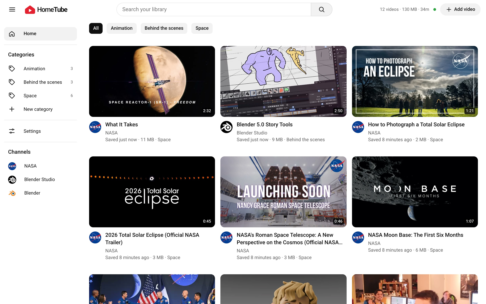
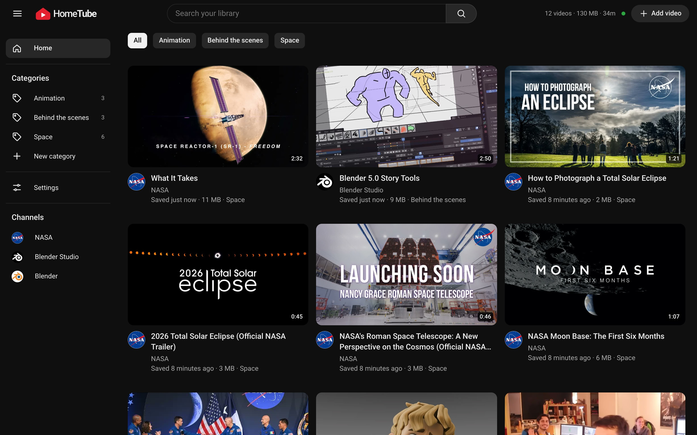
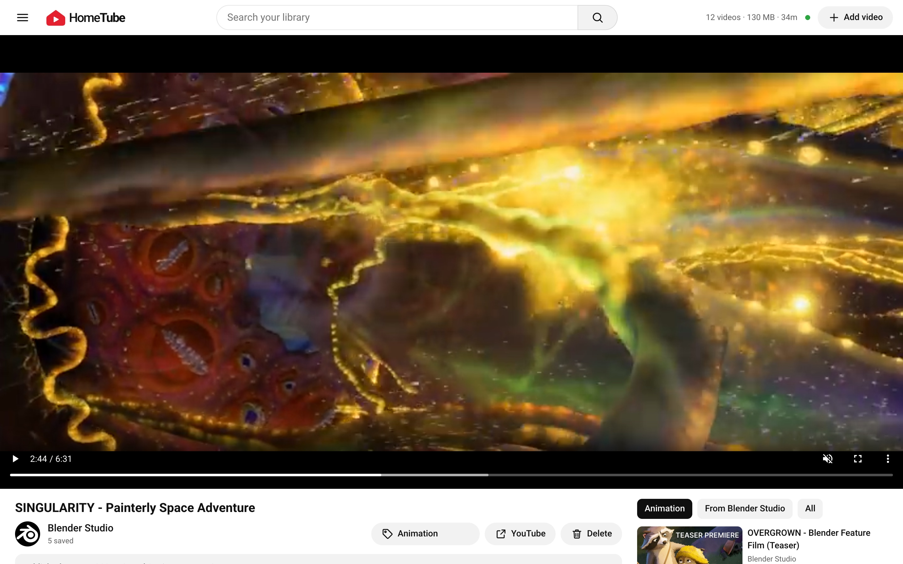
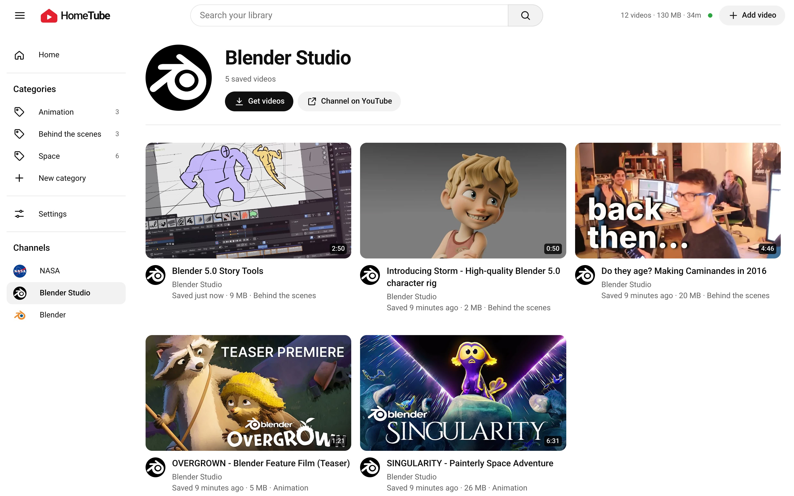
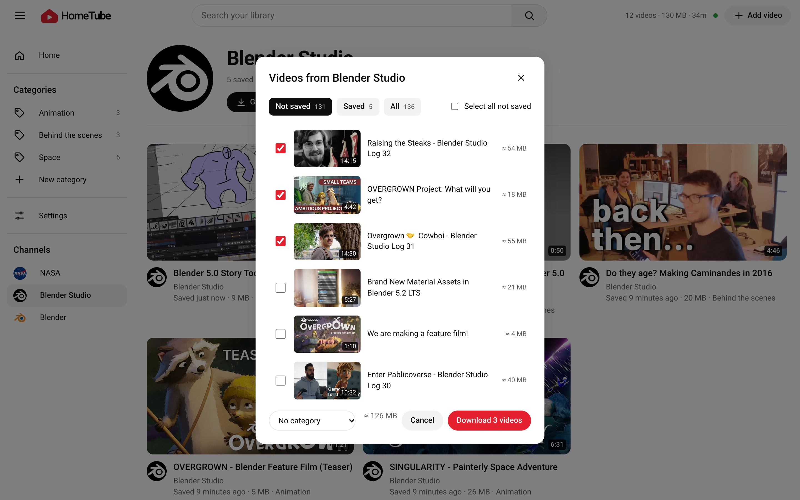
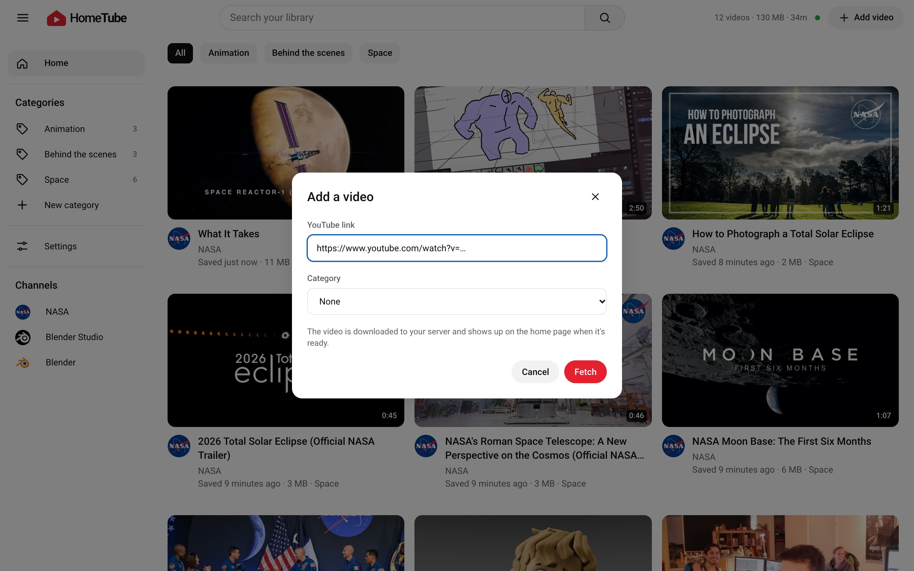
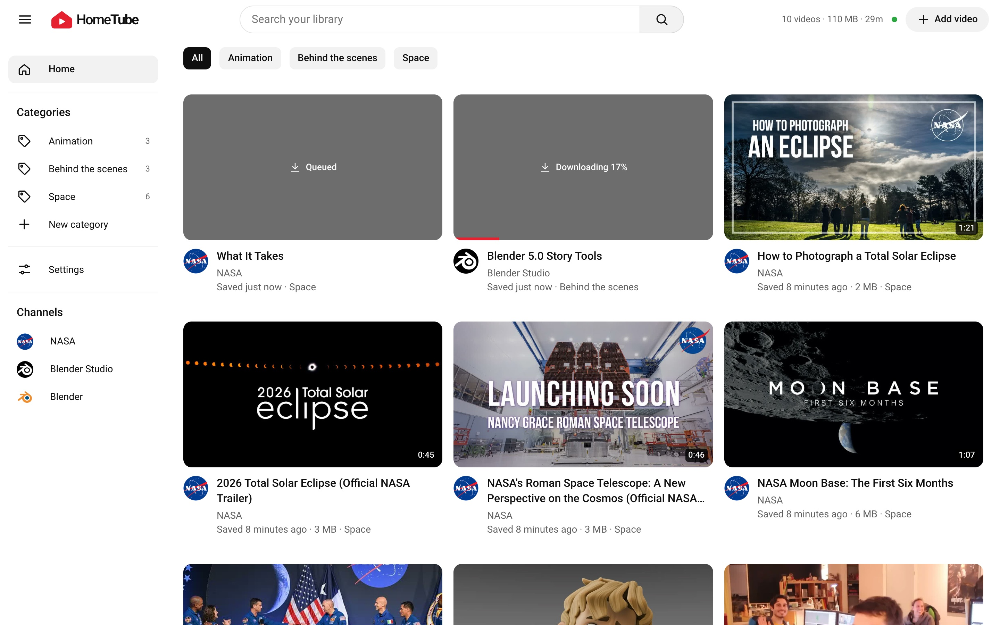
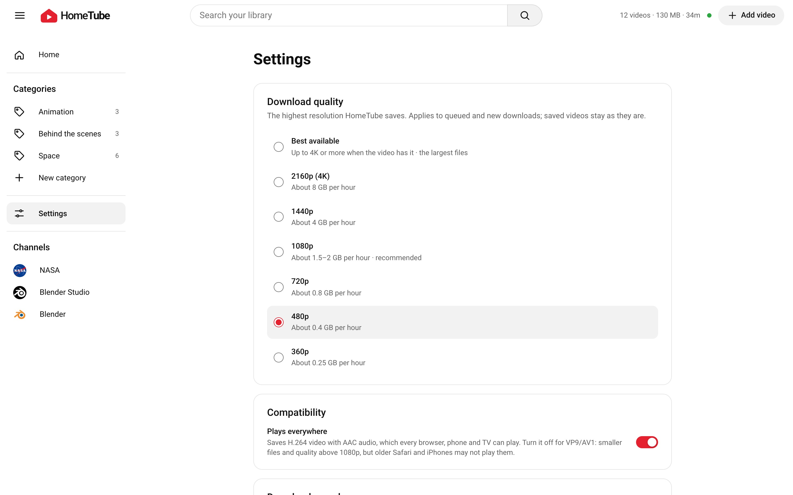

<p align="center">
  
</p>

<h1 align="center">HomeTube</h1>

<p align="center">
  Your own YouTube for the homelab.<br>
  Paste a link, HomeTube downloads the video or Short to your server, and you watch it on a familiar home page:<br>
  offline, ad-free, and long after the original is gone.
</p>

<p align="center">
  <a href="#install-with-docker-compose">Install</a> ·
  <a href="#features">Features</a> ·
  <a href="#configuration">Configuration</a> ·
  <a href="LICENSE">MIT License</a>
</p>

<table>
  <tr>
    <td width="50%"></td>
    <td width="50%"></td>
  </tr>
</table>

## Features

- **Save by link.** **Add video / Shorts** takes a video link (watch, youtu.be, embed, live), a Short (`youtube.com/shorts/…`), or a channel's Shorts page (`youtube.com/@name/shorts`) to save all of its Shorts at once. Pick a category right away if you like.
- **Shorts, like on YouTube.** Shorts get their own player: one vertical Short per screen, scroll, swipe or use the arrow keys for the next one. They play in a mixed order (the ones you haven't seen first), can be filtered by category, and stay out of the regular video grids.
- **A cinema-style player.** The video sits on a full-width black stage with the channel, category and description below and **up next** on the right. When a video ends, the next one from the same channel starts after a short countdown (the next episode first), which you can cancel.
- **Channels.** Videos are grouped by channel with its profile picture. On a channel's page, **Get videos** lists its uploads or its Shorts on YouTube, marks what you already have and downloads what you pick. **Refresh** reads the channel's name and picture again, and **Stop downloads** takes the channel's unfinished downloads off the queue.
- **Live downloads.** Every card shows its state as it happens: queued, the percentage, then processing. Downloads run one after another in the background, with a short break in between so YouTube doesn't take the server for a bot.
- **Survives a bad connection, and YouTube.** When the internet drops, a download waits and retries on its own. When YouTube asks to confirm you're not a bot, the whole queue pauses for a while and carries on by itself. Members-only videos are marked and never queued.
- **Settings for your bandwidth and screens.** The highest quality to save (360p up to 4K), files that play everywhere (H.264) or smaller and sharper ones (VP9/AV1), and a speed limit.
- **And the rest:** categories with counts in the sidebar and as chips on the home page, a home feed mixed by what's new, what you watched and your favourite categories, search across titles and channels, and light and dark themes that follow your system.

<table>
  <tr>
    <td width="33%"><br><sub>Watch page with up next</sub></td>
    <td width="33%"><br><sub>A channel's page</sub></td>
    <td width="33%"><br><sub>Picking uploads from a channel</sub></td>
  </tr>
  <tr>
    <td width="33%"><br><sub>Adding a link</sub></td>
    <td width="33%"><br><sub>Downloads in progress</sub></td>
    <td width="33%"><br><sub>Settings</sub></td>
  </tr>
</table>

## Use it responsibly

HomeTube is meant for a private homelab: download only videos you have the right to keep (your own uploads, content with a permissive license, or where the creator allows it), keep the server on your private network, and don't share the library publicly. Downloading may be against YouTube's Terms of Service; you are responsible for how you use it.

## Install with Docker Compose

Requirements: Docker with the Compose plugin.

```sh
git clone https://github.com/yasaricli/hometube.git
cd hometube
docker compose up -d --build
```

Open **http://localhost:3100** and click **Add video / Shorts**.

Videos are stored in the `media` folder next to `compose.yaml` (one folder per video with `video.mp4` and `thumb.jpg`, channel pictures under `media/channels`); the library itself lives in MongoDB's `mongo-data` volume. yt-dlp updates itself every time the container starts, so a `docker compose restart app` fixes most "can't download" errors after YouTube changes something.

To store videos somewhere else, for example on an external disk or a NAS mount, set `HOMETUBE_MEDIA_PATH` in a `.env` file next to `compose.yaml` (Compose reads it automatically) and run `docker compose up -d` again:

```sh
HOMETUBE_MEDIA_PATH=/mnt/nas/videos
```

On macOS, Docker Desktop must be allowed to access that folder (Settings → Resources → File sharing; `/Volumes` is shared by default).

## Updating

To move an existing install to the latest version, run this in the `hometube` folder:

```sh
git pull
docker compose pull mongo
docker compose up -d --build
```

Your videos stay in `media` and the library in the `mongo-data` volume; there is no migration step. Downloads that were running pick up where they left off.

## Configuration

All three variables are required; the app exits with `missing env X` if one is absent. Compose sets them for you. Download quality, compatibility and the speed limit are set on the **Settings** page.

| Variable      | Example                              |
| ------------- | ------------------------------------ |
| `MONGODB_URI` | `mongodb://localhost:27017/hometube` |
| `PORT`        | `3100`                               |
| `MEDIA_DIR`   | `./media`                            |

## Local development

Requires Node.js 24, MongoDB, [yt-dlp](https://github.com/yt-dlp/yt-dlp) and ffmpeg on your `PATH`.

```sh
cp .env.example .env
npm install
npm run dev     # http://localhost:3100
npm test        # link parsing, error classification, formats, feed order and up next
```

## How it works

A single Node process (`server.js`) runs Next.js, socket.io and the download queue. Adding a link reads the video's details with `yt-dlp -J`, saves it to MongoDB and queues it; the queue runs `yt-dlp` with the format from your settings and streams its progress to every open browser. Network errors put a video in a waiting state with growing delays instead of failing it, and YouTube's bot check pauses the whole queue for a while. Shorts are recognised from yt-dlp's `media_type`, a `/shorts/` link or the channel's Shorts tab, and download at the quality setting's width instead of its height. Finished files are served from `/media/<id>/…` with HTTP range support, so the player can seek.

Stack: Next.js, React, zustand, SCSS modules, socket.io, MongoDB (mongoose), yt-dlp, ffmpeg.

## Screenshot credits

The screenshots show openly licensed videos: films and making-of videos by [Blender Studio](https://studio.blender.org) and the [Blender Foundation](https://www.blender.org) (CC BY), and videos by [NASA](https://www.nasa.gov) (public domain). Their use here doesn't imply endorsement by either.

## License

[MIT](LICENSE)
