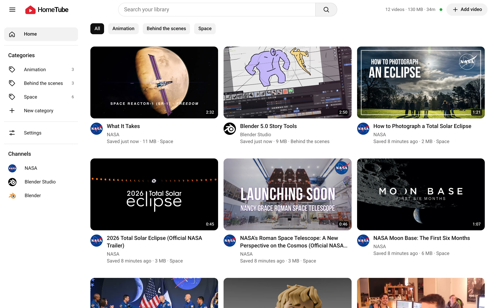
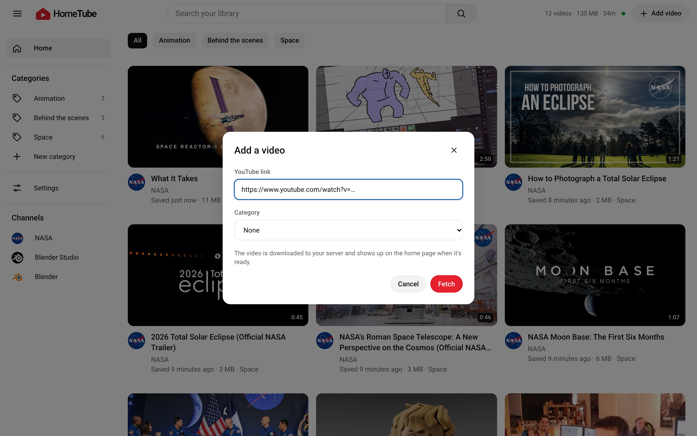
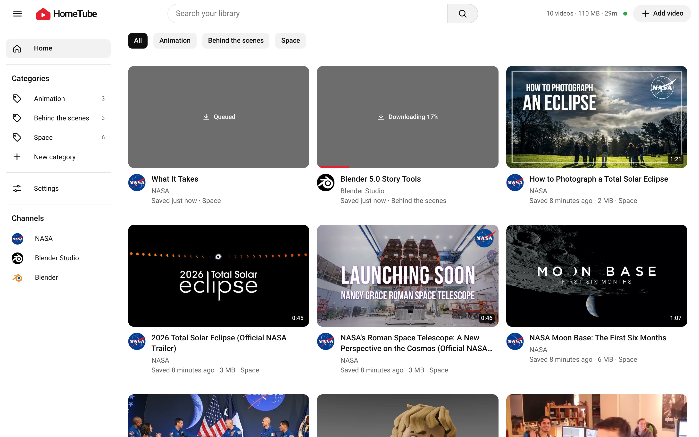
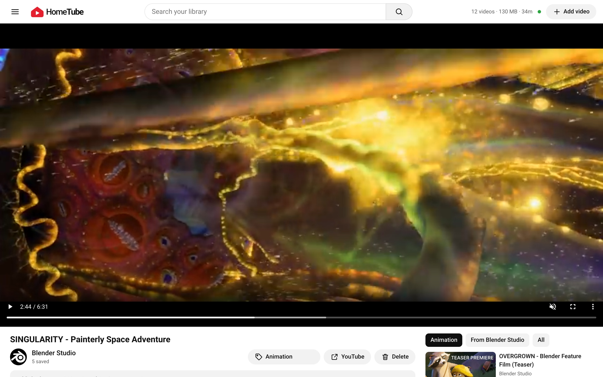
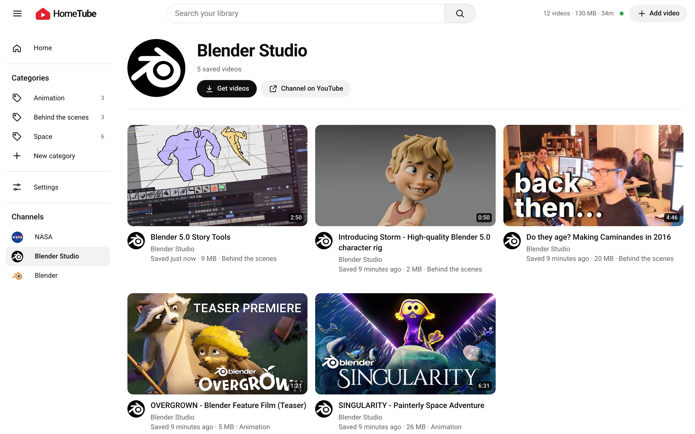
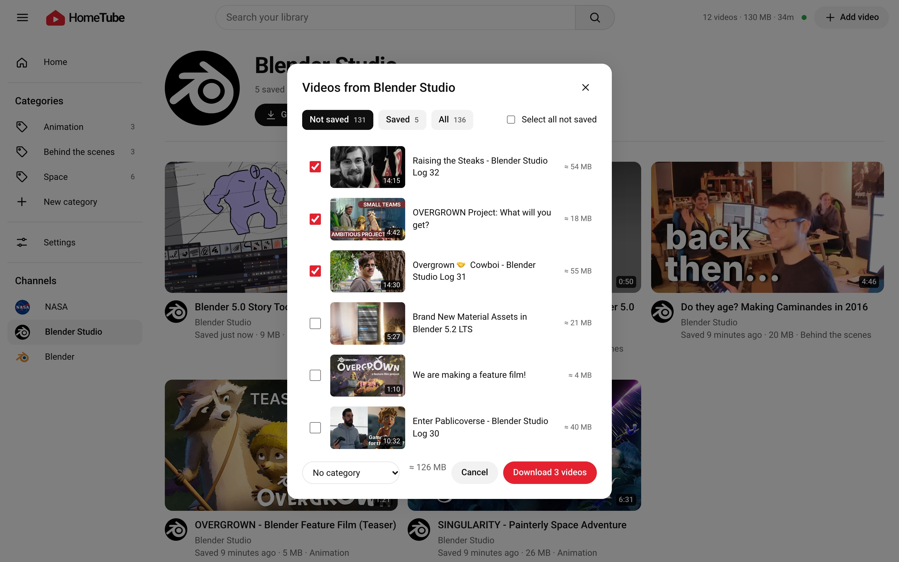
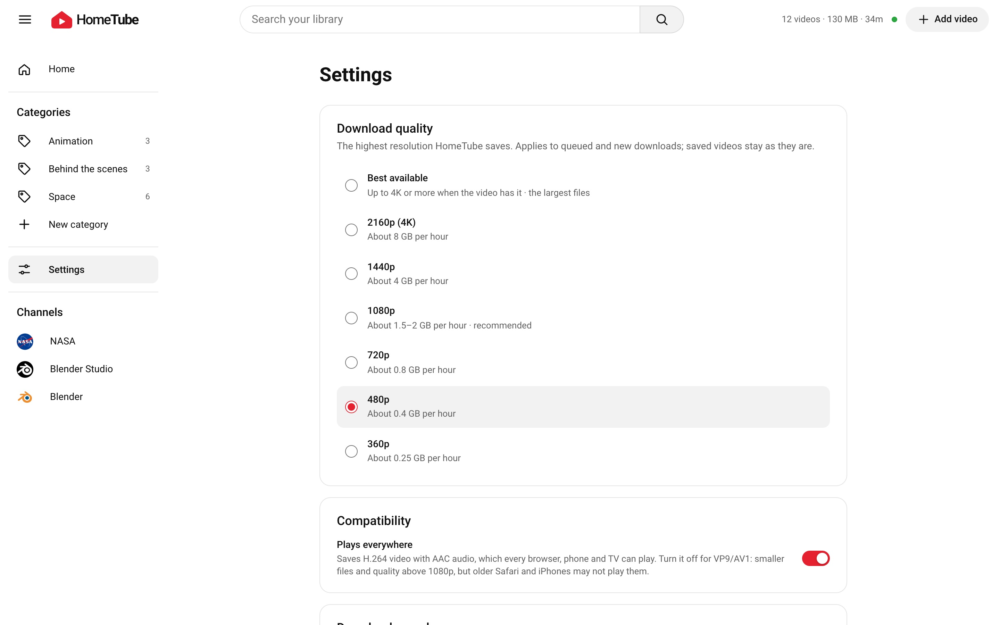
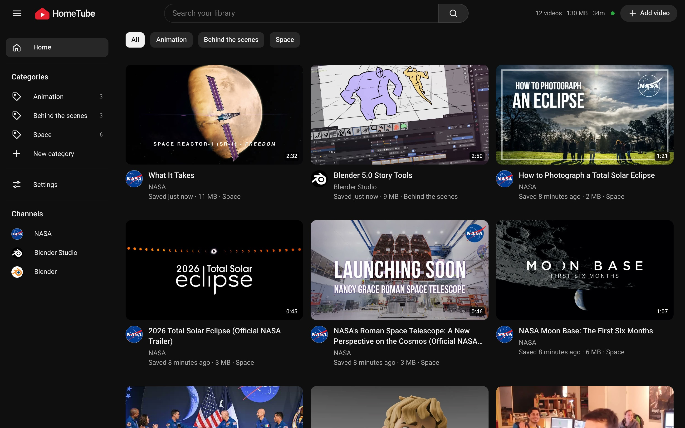

# HomeTube

Your own video library for the homelab. Paste a YouTube link, HomeTube downloads the video to your server, and it shows up on a familiar home page where you can watch it any time: offline, ad-free, and long after the original is gone.



## Features

### Save a video by its link

Click **Add video**, paste a YouTube link (watch, youtu.be, shorts, embed or live URLs) and press **Fetch**. Pick a category right away if you like.



### Watch the downloads happen

Every card shows its download live: queued, the percentage, then processing. Downloads run one after another in the background, and the top bar keeps a running total of what's on your server.



### A cinema-style player

The watch page puts the video on a full-width black stage. Below it: the channel, the category, a link back to YouTube and the description. On the right, **up next** shows more from the same category, the same channel, or everything.



### Channels, and getting their videos

Videos are grouped by channel automatically, with the channel's profile picture saved alongside. On a channel's page, **Get videos** lists its uploads on YouTube, marks the ones you already have, estimates their size, and downloads the ones you pick.





### Settings for your bandwidth and your screens

Choose the highest quality to save (360p up to 4K), whether files should play on every device (H.264) or be smaller and sharper (VP9/AV1), and a speed limit so downloads don't fill your connection.



### And the rest

- **Categories** in the sidebar with video counts, plus chips on the home page to filter by them.
- **Search** across titles and channel names.
- **Survives a bad connection.** When the internet drops, a download waits and retries on its own (15 s, 30 s, 1 min… up to every 5 min) and picks up where it left off; everything waiting starts again the moment a download succeeds.
- **Light and dark** themes follow your system.



## Use it responsibly

HomeTube is meant for a private homelab: download only videos you have the right to keep (your own uploads, content with a permissive license, or where the creator allows it), keep the server on your private network, and don't share the library publicly. Downloading may be against YouTube's Terms of Service; you are responsible for how you use it.

## Install with Docker Compose

Requirements: Docker with the Compose plugin.

```sh
git clone <this repository> hometube
cd hometube
docker compose up -d --build
```

Open **http://localhost:3100** and click **Add video**.

Videos are stored in the `media` folder next to `compose.yaml` (one folder per video with `video.mp4` and `thumb.jpg`, channel pictures under `media/channels`); the library itself lives in MongoDB's `mongo-data` volume. yt-dlp updates itself every time the container starts, so a `docker compose restart app` fixes most "can't download" errors after YouTube changes something.

To store videos somewhere else, for example on a NAS mount, put your own settings in `compose.override.yaml`:

```yaml
services:
  app:
    volumes: !override
      - /mnt/nas/videos:/media
```

## Updating

To move an existing install to the latest version, run this in the `hometube` folder:

```sh
git pull
docker compose pull mongo
docker compose up -d --build
```

Your videos stay in `media` and the library in the `mongo-data` volume; there is no migration step. Downloads that were running pick up where they left off.

## Configuration

All three variables are required; the app exits with `missing env X` if one is absent. Compose sets them for you. Download quality, compatibility and the speed limit are set on the **Settings** page.

| Variable      | Example                              |
| ------------- | ------------------------------------ |
| `MONGODB_URI` | `mongodb://localhost:27017/hometube` |
| `PORT`        | `3100`                               |
| `MEDIA_DIR`   | `./media`                            |

## Local development

Requires Node.js 24, MongoDB, [yt-dlp](https://github.com/yt-dlp/yt-dlp) and ffmpeg on your `PATH`.

```sh
cp .env.example .env
npm install
npm run dev     # http://localhost:3100
npm test        # link parsing, error classification and format self-check
```

## How it works

A single Node process (`server.js`) runs Next.js, socket.io and the download queue. Adding a link reads the video's details with `yt-dlp -J`, saves it to MongoDB and queues it; the queue runs `yt-dlp` with the format from your settings and streams its progress to every open browser. Network errors put a video in a waiting state with growing delays instead of failing it. Finished files are served from `/media/<id>/…` with HTTP range support, so the player can seek.

Stack: Next.js, React, zustand, SCSS modules, socket.io, MongoDB (mongoose), yt-dlp, ffmpeg.

## Screenshot credits

The screenshots show openly licensed videos: films and making-of videos by [Blender Studio](https://studio.blender.org) and the [Blender Foundation](https://www.blender.org) (CC BY), and videos by [NASA](https://www.nasa.gov) (public domain). Their use here doesn't imply endorsement by either.

## License

[MIT](LICENSE)
